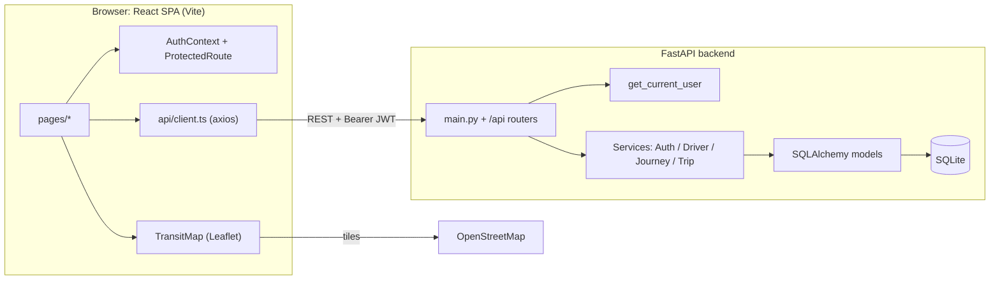
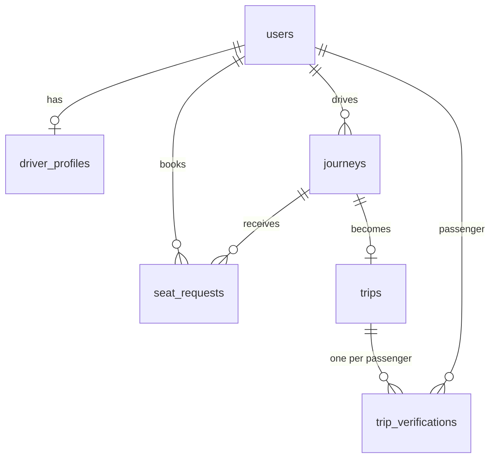

# StationPool

**Metro-first carpooling for Pune commuters.**

StationPool solves the "last mile" problem: you step off a Pune Metro train, but your office park is still several kilometres away. Drivers who commute that way publish a ride from a metro station to a tech park. Riders find a match, reserve a seat, and board using a 4-digit PIN.

> **Project status: prototype / demo.** OTP login is a demo, driver verification is simulated, and payments, ratings, SOS dispatch and the live map are placeholders. See [Current status](#current-status) and [Known limitations](#known-limitations) before using this for anything real.

---

## Table of contents

- [How it works](#how-it-works)
- [Features](#features)
- [Tech stack](#tech-stack)
- [Architecture](#architecture)
- [Project structure](#project-structure)
- [Getting started](#getting-started)
- [Using the app (demo walkthrough)](#using-the-app-demo-walkthrough)
- [API overview](#api-overview)
- [Data model](#data-model)
- [Testing](#testing)
- [Current status](#current-status)
- [Known limitations](#known-limitations)
- [Roadmap](#roadmap)

---

## How it works

1. **Driver publishes a ride:** metro exit station, destination tech park, seats, and a fuel-share amount.
2. **Rider searches:** picks their exit station and destination and sees matching open rides.
3. **Rider reserves a seat:** the booking is confirmed instantly and a trip is created.
4. **Boarding PIN:** the rider's phone shows a 4-digit PIN. The driver enters it at pickup. The server checks it against a stored hash, and the trip starts.
5. **Completion:** the driver taps *Complete Ride*. The rider's screen detects this and shows a summary with fare share and CO₂ saved.

---

## Features

**Implemented**

- Mobile-number sign-up and sign-in with OTP and JWT sessions (demo OTP, no real SMS)
- Driver registration with ID number masking (verification is simulated)
- Publish a feeder ride from a Pune Metro station (Aqua and Purple lines) to a tech park
- Search by origin station, destination and vehicle type (backend), with instant seat reservation
- PIN-based boarding verification: hashed PIN, 30-minute expiry, 5 attempts
- Trip lifecycle: confirmed → in progress → completed, with passenger-side polling
- Map views with Leaflet and OpenStreetMap
- Demo data seeding endpoint
- Backend test suite (14 tests)

**Placeholders / simulated**

- Nearby-driver markers on the radar map and the moving car on the active-ride map
- Payments ("Paid via UPI" is display text only)
- Ratings, green points and the activity history
- SOS "broadcast" (the phone-dial links do work)

---

## Tech stack

| Layer | Technology |
|---|---|
| Backend | Python, FastAPI, Uvicorn |
| Data validation | Pydantic v2 |
| ORM and database | SQLAlchemy 2, SQLite |
| Auth | HS256 JWT implemented with the Python standard library |
| Backend tests | pytest, FastAPI TestClient |
| Frontend | React 19, TypeScript, Vite |
| Routing and HTTP | react-router-dom 7, axios |
| Maps | Leaflet with OpenStreetMap tiles |
| Styling | Tailwind CSS (CDN), Plus Jakarta Sans, JetBrains Mono, Material Symbols |

---

## Architecture



The backend is layered: **routes** handle HTTP and validation, **services** hold business logic, and **models** map to database tables. Tables are created automatically at startup.

---

## Project structure

```
stationpool/
├── backend/
│   ├── app/
│   │   ├── main.py            # FastAPI app, routers, CORS, startup
│   │   ├── core/              # config.py (settings), security.py (JWT, OTP, PIN hashing)
│   │   ├── db/                # models.py (tables), database.py (engine, sessions)
│   │   ├── api/               # deps.py (auth dependency), routes/ (auth, driver, journeys, trips, stations, seed)
│   │   ├── services/          # auth, driver, journey and trip business logic
│   │   └── schemas/           # Pydantic request/response models
│   ├── tests/                 # model, service and API tests
│   └── requirements.txt
├── frontend/
│   ├── src/
│   │   ├── App.tsx            # route table
│   │   ├── api/client.ts      # axios client and endpoint helpers
│   │   ├── context/           # AuthContext
│   │   ├── pages/             # one file per screen
│   │   ├── components/        # Navbar, BottomNav, ProtectedRoute, SOSModal, TransitMap
│   │   └── utils/             # station/destination coordinates
│   └── package.json
└── <screen folders>/          # design exports (HTML + screenshots) used as UI references
```

---

## Getting started

### Prerequisites

- Python 3.13 or newer (tested on 3.13)
- Node.js 22 and npm
- Internet access while developing: Tailwind, fonts and Leaflet CSS are loaded from CDNs, and map tiles come from OpenStreetMap

### 1. Backend

Run these from the `backend/` folder. Start the server from this folder so the SQLite file is created there.

```bash
cd backend
python -m venv venv
source venv/bin/activate          # Windows: venv\Scripts\activate
pip install -r requirements.txt
uvicorn app.main:app --reload --port 8000
```

- API docs: <http://localhost:8000/docs>
- Health check: <http://localhost:8000/health>

The database file `stationpool.db` and all tables are created automatically on first start.

### 2. Load demo data

With the backend running, call the seed endpoint once. The easiest way is the **POST /api/seed** button in the `/docs` page, or:

```bash
curl -X POST http://localhost:8000/api/seed
```

This creates two demo drivers, one demo passenger and two open rides.

### 3. Frontend

```bash
cd frontend
npm install
npm run dev
```

Open the URL Vite prints, usually <http://localhost:5173>. The frontend calls the API at `http://<current hostname>:8000/api`, so the backend must be running on port 8000.

### Configuration

No environment variables are required; everything has a development default. Supported variables (read from the process environment) include `APP_ENV`, `APP_NAME`, `APP_VERSION`, `SECRET_KEY`, `ACCESS_TOKEN_EXPIRE_MINUTES` and `DATABASE_URL`.

> The app does not load a `.env` file automatically. To use one, start the server with `uvicorn app.main:app --env-file .env`, or export the variables in your shell.

---

## Using the app (demo walkthrough)

In development mode the OTP is always **`123456`** (the sign-in screen also has an auto-fill button).

1. Open the app and tap **Get Started**. Choose **Create Account**, enter a name and mobile number, and continue.
2. Enter OTP `123456`.
3. **As a rider:** on the home screen choose a station and destination, then **Find Matching Pool**. Pick a ride with **Match & Reserve Seat** to see your boarding PIN.
4. **As a driver:** open **Publish** from the bottom bar, fill in the route, seats and fuel share, and publish.
5. **Boarding:** on the rider's confirmation screen, use **Switch to Driver View**, enter the 4-digit PIN, then use **Complete Ride**.

To test both sides at once, use two browser profiles (or one normal and one private window) with different mobile numbers.

---

## API overview

All routes are under `/api`. Interactive docs are at `/docs`.

| Method and path | Auth | Purpose |
|---|---|---|
| `POST /auth/register` | none | Create or update a user and issue an OTP |
| `POST /auth/request-otp` | none | Issue an OTP for sign-in |
| `POST /auth/verify-otp` | none | Verify OTP, returns a JWT |
| `GET /auth/me` | JWT | Current user |
| `POST /driver/register` | JWT | Register driver and vehicle details |
| `GET /driver/profile` | JWT | Current driver profile |
| `POST /journeys/publish` | JWT | Publish a ride |
| `GET /journeys/search` | none | Search open rides (`origin_station`, `destination_zone`, `vehicle_category`) |
| `GET /journeys/{id}` | none | Ride details |
| `POST /journeys/request-seat` | JWT | Reserve seat(s) |
| `POST /trips/start` | none | Create or fetch the trip for a journey |
| `GET /trips/{id}` | none | Trip details, passengers and metrics |
| `GET /trips/{id}/pin` | JWT | Get or create a boarding PIN |
| `POST /trips/verify-pin` | JWT | Verify a PIN and start the trip |
| `POST /trips/complete` | JWT | Complete the trip |
| `GET /stations` | none | Metro stations and feeder destinations |
| `POST /seed` | none | Insert demo data |

---

## Data model



Ride status flows `open → full → in_progress → completed` (or `cancelled`). Trip status flows `confirmed → in_progress → completed`. Boarding PINs are stored only as hashes.

---

## Testing

```bash
cd backend
pytest
```

The suite has 14 tests covering models, services (auth, driver onboarding, ride lifecycle, PIN verification) and a few API routes, using an in-memory SQLite database.

Frontend:

```bash
cd frontend
npm run build    # type-checks and builds
npm run lint     # oxlint
```

There are currently no frontend tests.

---

## Current status

| Area | Status |
|---|---|
| Sign-up, OTP login, JWT | Working (demo OTP) |
| Publish, search, reserve | Working |
| PIN boarding and trip lifecycle | Working |
| Driver ID and licence verification | Simulated (auto-approved) |
| Payments, ratings, green points | Not implemented (display only) |
| SOS dispatch | Not implemented (display only) |
| Live tracking | Simulated |
| Activity history | Mock data |

---

## Known limitations

This is a prototype. Do not deploy it publicly as-is.

- **Login is not secure.** The OTP is returned in the API response, and `123456` is accepted when `APP_ENV` is `development` (the default).
- **Trip endpoints lack ownership checks.** Any logged-in user can request another passenger's PIN, verify PINs, or complete trips. Some trip and driver details are visible without logging in.
- **`/api/seed` is public.**
- **Default signing key.** `SECRET_KEY` falls back to a development value. Set your own.
- **Weak PIN storage.** A 4-digit PIN stored as unsalted SHA-256 can be reversed easily.
- **Seat booking has no locking**, so concurrent bookings could overbook a ride.
- **No role enforcement.** Anyone can publish a ride, even without registering as a driver.
- **SQLite and an in-memory PIN cache** limit it to a single process.
- Search ignores departure time, and past rides can remain listed.

---

## Roadmap

- [ ] Remove the OTP from responses, add a real SMS provider, and add rate limiting
- [ ] Enforce ownership and roles on trip and driver endpoints; gate or remove `/seed`
- [ ] Require a real `SECRET_KEY` and keep `.env`, the database file and caches out of git
- [ ] Longer, salted PIN or one-time code, with proper QR display
- [ ] Row-level locking for seat booking; cancellation and driver-approval flows
- [ ] Time-aware matching and departure-time selection
- [ ] Real payments, persisted ratings, and live GPS tracking
- [ ] Migrations (Alembic), Postgres, and CI with backend and frontend tests

---

## Acknowledgements

Map data © [OpenStreetMap](https://www.openstreetmap.org/copyright) contributors. Maps by [Leaflet](https://leafletjs.com/).
